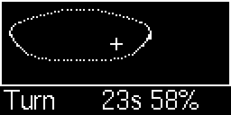
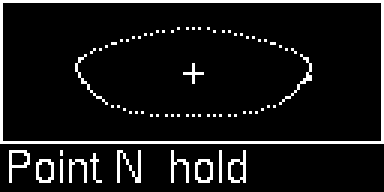
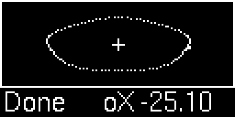
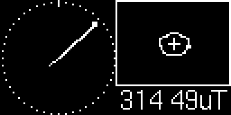

# Toit driver for the Bosch Sensortec BMM150 magnetometer

A Toit driver for the BMM150, a three-axis magnetometer. It returns the magnetic
field in microtesla (µT). The chip supports I2C and SPI. This driver implements
I2C only.

The chip has no temperature output. It measures the resistance of its Hall
plate instead, and the driver uses that value to correct the field readings.

Status: the driver has been checked against a simulated chip and against
numbers from Bosch's own C code. It has not been run on a real chip yet. See
[Limits](#limits) for what that leaves open.

## Use cases

The datasheet lists these typical applications:

- "Magnetic heading information"
- "Tilt-compensated electronic compass for map rotation, navigation and augmented reality"
- "Gyroscope calibration in 9-DoF applications for mobile devices"
- "In-door navigation, e.g. step counting in combination accelerometer"
- "Gaming"

Some ideas that go beyond the datasheet's list. They are suggestions, and none
has been tried with this driver:

- A compass or heading indicator. You will need a calibration for steel and
  magnets near the sensor. `src/calibration.toit` is a helper for making one, and
  the driver applies it if you pass it with `--calibration`.
- Sensing a magnet, for example on a lid, a door or a knob. The datasheet gives
  the field range as "±1300µT (x, y-axis), ±2500µT (z-axis)".
- A magnetic joystick or position sensor, with a magnet on the moving part.
- Logging the field strength over time to see changes in the surroundings.
- Battery projects that only need a reading now and then. The datasheet says
  forced mode is "useful to achieve synchronized operation between host
  microcontroller and BMM150", and the chip rests in sleep mode between
  readings.

## Wiring

Four wires: power, ground, SDA and SCL. The I2C address is 0x10 by default. The
CSB and SDO pins move it:

| CSB | SDO | Address |
| -- | -- | -- |
| GND | GND | 0x10 |
| GND | VDDIO | 0x11 |
| VDDIO | GND | 0x12 |
| VDDIO | VDDIO | 0x13 |

The chip picks I2C or SPI from its PS pin. The datasheet says "In case the I²C
interface is used, a direct electrical connection between VDDIO supply and the
PS pin is recommended in order to ensure reliable protocol selection." A
breakout board probably does this for you, which is a guess. Check yours.

The chip takes "VDD supply voltage range: 1.62V to 3.6V" and "VDDIO interface
voltage range: 1.2V to 3.6V" (datasheet). Keep every interface line low or
floating while VDDIO is off: "It is absolutely prohibited to keep any interface
at a logical high level when VDDIO is switched off."

Change the pin numbers to match your board when using the examples. The chip
has two output pins that you can wire to free GPIOs. DRDY goes high when a new
measurement is ready, which lets the ESP32 wait on the pin instead of asking the
chip over I2C. INT reports the threshold and overflow interrupts. The example
`data-ready-interrupt.toit` uses DRDY.

## Quick start

```
import i2c
import bmm150 show Bmm150

main:
  bus := i2c.Bus --sda=21 --scl=20
  sensor := Bmm150 (bus.device Bmm150.I2C-ADDRESS)
  print sensor.read-mag-compensated  // The field in µT.
```

The constructor powers up the chip, resets its settings, reads the factory trim
values, applies the regular preset (10 Hz) and starts normal mode. Pass
`--preset` and `--odr` to start with other settings.

## Reading data

`read-raw-data` returns the 8 bytes of one measurement: X, Y, Z and the Hall
resistance. `read-mag-compensated`, `read-mag-raw`, `read-rhall` and
`has-overflow` turn those bytes into numbers. Pass the same bytes to several of
them and every value comes from the same instant. Call them without an argument
and each call waits for a fresh measurement.

`read-mag-compensated` applies the trim values that Bosch stores in the chip. If
you gave the driver a calibration (see below), it is applied last. `read-mag-raw`
skips all of that and returns the register counts, which are not µT. It is mostly
useful for comparison.

The chip stores the four values together and updates them at once. The datasheet
recommends reading them the same way: "it is recommended to read out at all data
at once (0x42 to 0x49 or 0x4A if status bits are also required) with a burst
read." `read-raw-data` does that.

When an axis goes out of range, the chip fills its register with the most
negative value, "-4096" for X and Y and "-16384" for Z. Bosch's code then
returns 0.0. This driver throws instead, since a zero looks like a real reading.
Call `has-overflow` first if you want to handle it yourself.

## Presets, rate and power modes

The chip lets you trade noise against current by changing how many repetitions
it makes per measurement. The datasheet lists four presets (table 3):

| Preset | X/Y repetitions | Z repetitions | Rate | Noise X/Y/Z | Current |
| -- | -- | -- | -- | -- | -- |
| `PRESET-LOW-POWER` | 3 | 3 | 10 Hz | 1.0/1.0/1.4 µT | 0.17 mA |
| `PRESET-REGULAR` | 9 | 15 | 10 Hz | 0.6/0.6/0.6 µT | 0.5 mA |
| `PRESET-ENHANCED` | 15 | 27 | 10 Hz | 0.5/0.5/0.5 µT | 0.8 mA |
| `PRESET-HIGH-ACCURACY` | 47 | 83 | 20 Hz | 0.3/0.3/0.3 µT | 4.9 mA |

`set-preset` writes the repetitions and the rate of a preset. `set-odr` changes
the rate alone, and `set-repetitions --xy=... --z=...` changes the repetitions
alone. The rates are 2, 6, 8, 10, 15, 20, 25 and 30 Hz. A measurement has to fit
inside the period. The datasheet gives the highest forced mode read-out rate as
`f max,ODR ≈ 1 / (145µs × nXY + 500 µs × nZ + 980 µs)`, and
`Bmm150.measurement-time-us` returns the denominator.

`set-mode` switches between `MODE-NORMAL`, `MODE-FORCED`, `MODE-SLEEP` and
`MODE-SUSPEND`. Normal mode measures at the chosen rate. Forced mode takes one
measurement and returns to sleep mode, so `set-mode MODE-FORCED` followed by
`read-raw-data` gives one reading. Suspend mode uses the least current, but the
datasheet says "All registers lose their content, except the control register
(0x4B)". The driver keeps a copy of the settings it wrote and writes them back
when it wakes the chip, which takes the 3 ms start-up time. Until then it throws
if you try to use the chip, since the registers would not answer.

## Examples

All examples use the pins from the wiring section. Be sure to change them when
required.

- `read-simple.toit` prints 100 compensated readings.
- `read-verbose.toit` prints raw and compensated readings with their strength
  and the Hall resistance.
- `configure-rate.toit` picks a preset and a rate, and prints what the chip
  uses and how long one measurement takes.
- `read-forced-mode.toit` takes one reading a second in forced mode.
- `heading.toit` turns the X and Y field into a compass angle. It assumes the
  board is level and has no calibration.
- `data-ready-interrupt.toit` waits on the DRDY pin and reads a sample each time
  the chip says one is ready. It needs DRDY wired to GPIO 7.
- `calibrate.toit` collects readings while you turn the board, then prints a
  calibration to paste into your code. It shows the calibrated result as an X-Y
  scatter plot on a 128x64 SSD1306 display.
- `compass-display.toit` shows a compass dial and an X-Y scatter plot on a
  128x64 SSD1306 display. It needs the output of `calibrate.toit`. See the next
  section.
- `display-views.toit` holds the drawing code that the two display examples
  share.

## Calibration and the display demo

The chip's own trim values do not remove what the rest of the board adds to
the field. A magnet, a steel screw or a wire with current in it shifts the
reading by an amount that turns with the board. `src/calibration.toit` has two
small classes for that. Give a `MagCalibration` to the driver with the
`--calibration` argument, and `read-mag-compensated` applies it after the chip's
own corrections:

```
import bmm150
import bmm150.calibration show MagCalibration

CALIBRATION ::= MagCalibration
    --offset-x=-103.442
    --offset-y=31.554
    --offset-z=-177.869
    --scale-x=1.0779
    --scale-y=1.0861
    --scale-z=0.8684

main:
  ...
  sensor := bmm150.Bmm150
      bus.device bmm150.Bmm150.I2C-ADDRESS
      --calibration=CALIBRATION
  print sensor.read-mag-compensated  // Corrected for the board as well.
```

The numbers above are made up for the example. `read-mag-raw` never applies a
calibration. You can also set `sensor.calibration = ...` at any time, and `null`
takes it away again. To apply one by hand, call `CALIBRATION.apply` on a reading.

`MagCalibrator` collects readings and works out the offsets and the axis scales
with the min/max method. It is a common technique, and it comes from neither the
datasheet nor Bosch. It handles a steady offset (hard-iron) well, and a
difference in axis sensitivity in a simple way. It does not fit a tilted
ellipsoid. The datasheet gives a "Zero-B offset" of "±40" µT at 25 °C before
calibration and "±2" µT after calibrating with Bosch's own eCompass software,
which is a better method than this one.

The two display examples put SDA on GPIO 21 and SCL on GPIO 20, with the display
on the same I2C bus as the sensor. They need two more packages, `pixel_display`
and `ssd1306`. Run `toit pkg install` in `examples` once, after cloning this
repo. To calibrate:

| Steps | Display |
| -- | -- |
| 1. Mount the board where it will stay, with its wires and battery in place. <br> 2. Run `calibrate.toit` and turn the board through every orientation for 40 seconds. The scatter plot shows the raw X and Y readings. <br>3. Hold the board level with the top of the display towards north when it says "Point N", then a quarter turn clockwise, towards east, when it says "Point E". Use a compass you trust to find north, away from steel and magnets. This works out `ROTATE-DEGREES` and `MIRROR`. |  <br> <br>  |
| 4. Copy the lines it prints in the console into `compass-display.toit`. The display also shows all the values after "Done", one by one, for when the board runs from a battery. <br> 5. Run `compass-display.toit`. Turn the board flat on a table. The needle should keep pointing the same way in the room, and the dots should trace a ring. |  |

The pictures come from a stand-in display with made-up readings, not from a
photo of a real module, so your traces will differ. They are the same ones used
for the BMM350 driver.

The dial assumes that the board is level, that the chip's +X axis points to the
top of the display, and that Z points up. Those are assumptions, and the real
directions depend on your breakout. `calibrate.toit` measures `ROTATE-DEGREES`
and `MIRROR` for you from the two poses. The mirror test rests on my assumption
that a clockwise turn raises the field angle by 90 degrees when the chip's Z axis
points up. If the needle still misbehaves, change `ROTATE-DEGREES` or `MIRROR` by
hand. If the picture on the screen is turned, set `DISPLAY-ROTATION` to 90, 180
or 270 in `calibrate.toit` and `compass-display.toit`. It turns the picture
clockwise from how it looked before the setting existed, and a tall picture (90
or 270) puts the parts of the screen underneath each other. If the picture is a
mirror image, set `DISPLAY-FLIP` to `true`. These two settings are about the
screen, and `ROTATE-DEGREES` and `MIRROR` are about the chip.

A calibration belongs to the whole assembly, not only to the chip. Another board
built the same way will probably need its own numbers. `to-map` and `from-map`
turn a calibration into a map of numbers, which makes it easy to keep one per
device in a file, flash, or a
[flash backed bucket](https://libs.toit.io/system/storage/class-Bucket) (stored
on the ESP32 directly).

## Tests

The tests are for working on the driver, and you do not need them to use it.
They are described in [tests/README.md](tests/README.md).

## Limits

- Not run on a real chip yet. The mock test and the comparison with Bosch's code
  cover the register handling and the maths. They cannot show timing, the
  chip's reaction to illegal sequences, or the points below.
- Z repetitions are an open question. The datasheet's register text for Z gives
  `nZ = 1 + REPZ` (section 5.8). Its preset table and Bosch's code only fit
  `1 + 2 * REPZ`. The driver follows the table. `bmm150-hardware-test.toit` times
  a forced measurement for both readings and fails if the chip follows the text.
- The threshold registers (0x4F and 0x50) are treated as signed bytes. The
  datasheet does not say. The interrupt tests in `bmm150-hardware-test.toit`
  only use -128 and 127.
- The datasheet gives no wait time after a soft reset. The driver waits 3 ms,
  where Bosch's code waits 1 ms.
- The datasheet is inconsistent about where the interrupt latch bit lives
  (section 4.6.1 says register 0x4A, table 20 says 0x4E). The driver follows
  table 20 and Bosch's code.
- The trim registers (0x5D to 0x71) and the compensation formulas are not in the
  datasheet. They come from Bosch's reference code (`bmm150.c`, floating-point
  version), and the golden vectors in the tests come from that code.
- Not implemented: SPI, the advanced self-test (it needs Bosch's application
  note for the thresholds), and the data overrun interrupt beyond reporting its
  flag.

## Links

- [Datasheet](https://www.bosch-sensortec.com/media/boschsensortec/downloads/datasheets/bst-bmm150-ds001.pdf)
- [Bosch's sensor API](https://github.com/boschsensortec/BMM150_SensorAPI) with
  functions and examples.

## Issues

If you find a problem or have a change to suggest, please
[raise an issue](./issues). Feedback is welcome.

## Disclaimer

- All trademarks belong to their respective owners.
- No warranties for this work, express or implied.

## Credits

- [Florian](https://github.com/floitsch) for help and encouragement.
- The wider Toit developer team, past and present, for a truly excellent product.

## About Toit

You are probably here because you know what Toit is. If not:
> Toit is a high-level, memory-safe language, with container/VM technology built
> specifically for microcontrollers (not a desktop language port). It gives fast
> iteration (live reloads over Wi-Fi in seconds), robust serviceability, and
> performance that’s far closer to C than typical scripting options on the
> ESP32. [[link](https://toitlang.org/)]
- [Review on Soracom](https://soracom.io/blog/internet-of-microcontrollers-made-easy-with-toit-x-soracom/)
- [Review on eeJournal](https://www.eejournal.com/article/its-time-to-get-toit)
